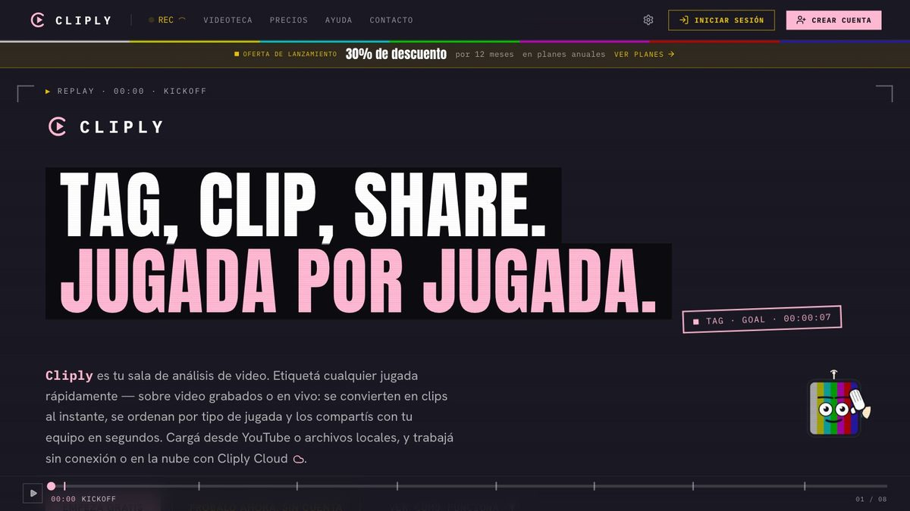
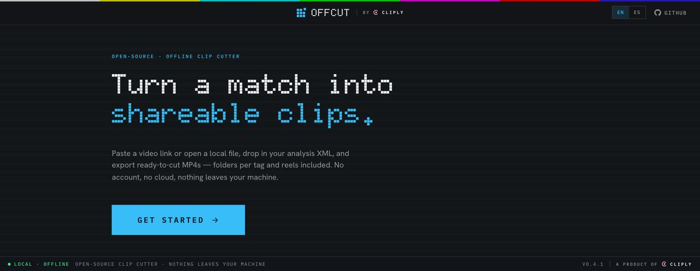
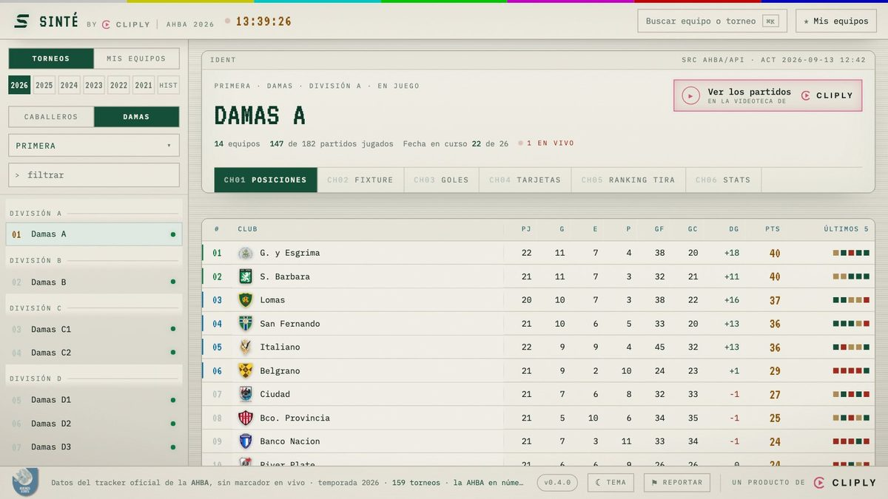

<picture>
  <source media="(prefers-color-scheme: dark)" srcset="https://raw.githubusercontent.com/cliply-video/.github/main/profile/brand/cliply-lockup-on-dark.svg" />
  
</picture>

**Video analysis for sport — tag, cut and share clips fast.** 
The family also includes Offcut, our free offline clip cutter, and Sinté, a hockey tournament control room — both products of cliply.

  <a href="https://cliply.video/?utm_source=github&utm_medium=org-profile&utm_campaign=profile&utm_content=header">cliply.video&nbsp;↗</a>
  &nbsp;·&nbsp;
  <a href="https://offcut.cliply.video">Offcut&nbsp;↗</a>
  &nbsp;·&nbsp;
  <a href="https://sinte.ar">Sinté&nbsp;↗</a>

  
  
  

## The cliply family

### cliply

Sports video analysis for coaches and analysts. Tag events live or after the match, cut clips, and build a shared library of collections, players and teams — with AI-assisted analysis, public share links, cloud storage and team workspaces, plus a desktop companion app. Paid SaaS, free to start.

<a href="https://cliply.video/?utm_source=github&utm_medium=org-profile&utm_campaign=profile&utm_content=body">cliply.video&nbsp;↗</a>

---

<picture>
  <source media="(prefers-color-scheme: dark)" srcset="https://raw.githubusercontent.com/cliply-video/.github/main/profile/brand/offcut-lockup-dark.png" />
  
</picture>

Free, open-source, 100% offline desktop clip cutter. Paste a YouTube link or open a local file, optionally import a SportsCode / Nacsport analysis XML, review the clips, and export MP4s with ffmpeg — per-tag folders and reels included. No account, no cloud. Tauri + React + Rust, for macOS, Windows and Linux.

  <a href="https://offcut.cliply.video">offcut.cliply.video&nbsp;↗</a>
  &nbsp;·&nbsp;
  <a href="https://github.com/cliply-video/cliply-exporter/releases/latest">Download&nbsp;↗</a>

---

<picture>
  <source media="(prefers-color-scheme: dark)" srcset="https://raw.githubusercontent.com/cliply-video/.github/main/profile/brand/sinte-lockup-dark.png" />
  
</picture>

AHBA (Buenos Aires hockey association) tournaments in a CRT control room. Live standings, fixtures, stats and cards, read straight from the official tracker. Unofficial.

<a href="https://sinte.ar">sinte.ar&nbsp;↗</a>

<a href="https://sinte.ar">
  <picture>
    <source media="(prefers-color-scheme: dark)" srcset="https://raw.githubusercontent.com/cliply-video/.github/main/profile/brand/sinte-screenshot-dark.jpg" />
    
  </picture>
</a>

## Open source

| Project | What it is |
| ------- | ---------- |
| [**Offcut**](https://github.com/cliply-video/cliply-exporter) | Free, offline clip cutter — Tauri + React + Rust. macOS / Windows / Linux. |

 

Need cloud, teams &amp; live sharing? → <a href="https://cliply.video/?utm_source=github&utm_medium=org-profile&utm_campaign=profile&utm_content=footer">cliply.video</a>

