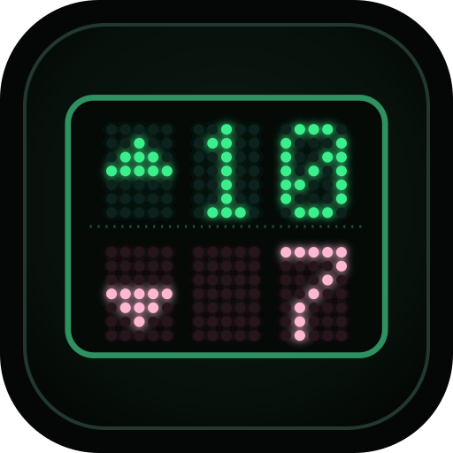
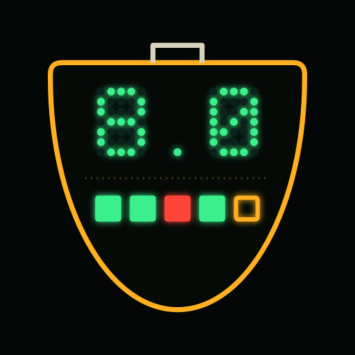

<picture>
  <source media="(prefers-color-scheme: dark)" srcset="https://raw.githubusercontent.com/cliply-video/.github/main/profile/brand/cliply-lockup-on-dark.svg" />
  
</picture>

**Video analysis for sport — tag, cut and share clips fast.** 
Plus a family of hockey tools and games around it, all products of cliply.

  <a href="https://cliply.video/?utm_source=github&utm_medium=org-profile&utm_campaign=profile&utm_content=header">cliply.video&nbsp;↗</a>
  &nbsp;·&nbsp;
  <a href="https://tools.hockey">tools.hockey&nbsp;↗</a>
  &nbsp;·&nbsp;
  <a href="https://cliply.video/roadmap?utm_source=github&utm_medium=org-profile&utm_campaign=profile&utm_content=header">Roadmap&nbsp;↗</a>

## cliply

| | |
| :-: | --- |
|  | **[cliply](https://cliply.video/?utm_source=github&utm_medium=org-profile&utm_campaign=profile&utm_content=body)** — sports video analysis for coaches and analysts. Tag live or after the match, cut clips, draw on the video, build collections and presentations, share by link, AI match reports and cloud storage for the whole staff. Connects to Claude and ChatGPT. Free to start. |
|  | **[cliply for Chrome](https://chromewebstore.google.com/detail/lcffhegabkohgapcfgjfjpdeoocpojff)** — send the YouTube video you are watching straight to a cliply project. |

## Tools

| | |
| :-: | --- |
|  | **[Sinté](https://sinte.ar)** — all the hockey you care about in one place: fixtures, results, standings and squads for the AHBA and other leagues, in a CRT control room. Unofficial. |
|  | **[thebench](https://thebench.ar)** — minutes, rotations and stats from the sideline. Offline-first PWA for the bench tablet; exports to cliply for video overlays. |
|  | **[convoca](https://convoca.cliply.video)** — hockey call-ups: squad from Sinté, lineup, set pieces, time and place, sent over WhatsApp with a short link. |
|  | **[offcut](https://offcut.cliply.video)** — open-source, offline desktop video toolbox. Cut clips from a YouTube link or a local file, import SportsCode / Nacsport XML, export MP4s. macOS, Windows and Linux. |
|  | **[tools.hockey](https://tools.hockey)** — the one page that lists the whole family. |

## Games

| | |
| :-: | --- |
|  | **[8sec](https://8sec.cliply.video)** — the hockey shoot-out: 1 vs 1 from the 23 m line, eight seconds to score. Daily challenge, online duels and five keepers. |
|  | **[cornr](https://cornr.cliply.video)** — the penalty corner: read the defence, pick the play, inject, stop and drag-flick. |
|  | **[dribbl](https://dribbl.cliply.video)** — endless dribbling runner: dodge defenders or lift the ball over their sticks. |

## Open source

| Project | What it is |
| ------- | ---------- |
| [**offcut**](https://github.com/cliply-video/offcut) | Offline desktop video toolbox — Tauri + React + Rust. |
| [**roadmap**](https://github.com/cliply-video/roadmap) | Public roadmap for cliply: request a feature, vote on what ships next. |

 

Questions? <a href="mailto:hi@cliply.video">hi@cliply.video</a> · <a href="https://cliply.video/?utm_source=github&utm_medium=org-profile&utm_campaign=profile&utm_content=footer">cliply.video</a>

